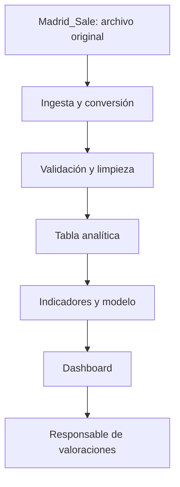

# Project brief: análisis del mercado residencial de Madrid

## 1. Resumen del proyecto

Este proyecto analizará los precios anunciados de viviendas en venta en Madrid durante 2018 utilizando el conjunto de datos abierto `idealista18`, limitado a `Madrid_Sale`. El objetivo es identificar cómo se relacionan las características de las viviendas y su localización con el precio anunciado por metro cuadrado.

La solución propuesta combina un dashboard para explorar segmentos del mercado y un modelo predictivo que estime el precio anunciado por metro cuadrado. Su destinatario será el responsable de valoraciones de una agencia inmobiliaria ficticia.

El análisis se plantea como un ejercicio histórico. Los precios corresponden a anuncios, no a operaciones cerradas, y los resultados no representan el mercado actual.

## 2. Contexto de negocio y decisión

La organización propuesta es **Madrid Vivienda Analytics**, una agencia inmobiliaria ficticia interesada en mejorar la comparación de inmuebles y la revisión de sus precios de salida.

El departamento destinatario será el equipo de valoraciones y captación. Su responsable consultaría el dashboard semanalmente en un escenario operativo, aunque este prototipo utilizará datos históricos estáticos.

La decisión que se quiere apoyar es:

> ¿Qué viviendas presentan un precio anunciado por metro cuadrado alejado del de inmuebles comparables y deberían revisarse antes de recomendar un precio de salida?

El dashboard permitirá seleccionar viviendas comparables según periodo, superficie, características y localización. El modelo ofrecerá una referencia adicional, que deberá interpretarse junto con el conocimiento del agente.

Los principales límites serán el calendario académico, el uso de herramientas gratuitas, la ausencia de precios de cierre y la falta de información sobre negociación, reformas interiores y condiciones particulares de venta. Las recomendaciones requerirán revisión humana.

## 3. Dataset card

| Campo | Descripción |
|---|---|
| Nombre | `idealista18`: subconjunto `Madrid_Sale` |
| Fuente | Repositorio de paezha, elaborado con anuncios de idealista y enriquecimiento catastral |
| URL | https://github.com/paezha/idealista18 |
| Licencia declarada | Open Database License, ODbL 1.0 |
| Enlace de licencia | https://opendatacommons.org/licenses/odbl/1-0/ |
| Archivo seleccionado | `data/Madrid_Sale.rda` |
| Formato | RDA; se convertirá a un formato tabular para el análisis |
| Periodo | Cuatro trimestres de 2018 |
| Volumen documentado | 94.815 registros y 42 variables, incluida la geometría |
| Tamaño aproximado | 6,74 MB para el archivo RDA |
| Unidad de observación | Registro de una vivienda anunciada; un mismo inmueble puede aparecer varias veces |
| Identificador | `ASSETID`; no se asumirá que identifica de forma única cada fila |
| Variable temporal | `PERIOD`, con códigos trimestrales |
| Dimensiones categóricas | Periodo, terraza, ascensor, localización interior/exterior y equipamiento |
| Medidas numéricas | Precio anunciado, superficie construida y precio por metro cuadrado |
| Variable objetivo | `UNITPRICE`, precio anunciado en €/m² |
| Diccionario | README y documentación del repositorio |
| Fecha y versión de descarga | Pendientes; se registrarán junto con el commit de origen |
| Fuentes adicionales | No se incorporarán fuentes externas en esta primera fase |

Las cifras anteriores proceden de la documentación y se verificarán al cargar el archivo. El dataset supera documentalmente el mínimo de 5.000 registros y cubre los cuatro trimestres de un año. No permite estudiar estacionalidad de varios años.

## 4. Calidad y preparación de los datos

Antes de limpiar se comprobarán dimensiones, tipos, valores ausentes, duplicados y rangos. También se verificará la distribución de registros por trimestre y la repetición de `ASSETID`.

La documentación presenta posibles problemas: abundantes ausencias y valores poco plausibles en el año de construcción declarado, cantidades extremas de habitaciones y distancias que requieren revisión geográfica. Estas observaciones son indicios documentados, todavía no resultados de una auditoría propia.

El tratamiento previsto será:

- Conservar una copia original y registrar cada transformación.
- Interpretar `PERIOD` como trimestre, sin inventar fechas exactas de publicación.
- Distinguir duplicados exactos de apariciones repetidas de una vivienda.
- Validar superficies, precios, habitaciones, coordenadas y distancias.
- Convertir indicadores y códigos en categorías comprensibles.
- Evaluar el año catastral como alternativa al año declarado.
- Documentar las exclusiones y su efecto sobre la muestra.

Los valores extremos no se eliminarán automáticamente. Se distinguirán errores de viviendas excepcionales. Las coordenadas se tratarán como aproximadas, pues la fuente informa de perturbaciones para anonimizar los datos.

## 5. Hipótesis de negocio

Se priorizan las hipótesis por su utilidad para seleccionar comparables y revisar valoraciones.

| Prioridad e hipótesis | Métrica y dirección esperada | Comprobación | Acción según resultado |
|---|---|---|---|
| H1. Una mayor distancia al centro se asocia con menor precio por m² | Mediana de `UNITPRICE` por tramo de distancia; relación negativa | Dispersión, correlación de Spearman y comparación por superficie | Si se cumple, incorporar distancia en los comparables; si no, revisar otras dimensiones de localización |
| H2. Las viviendas de mayor superficie presentan menor precio por m² | Mediana de `UNITPRICE` por intervalo de superficie; descenso esperado | Diagramas de caja y Spearman, considerando localización | Si se cumple, comparar por tamaño; si no, reducir el peso de esta segmentación |
| H3. Disponer de ascensor se asocia con mayor precio por m², especialmente en plantas altas | Diferencia de medianas entre viviendas con y sin ascensor por planta; positiva | Tabla agrupada y diagramas de caja | Si se cumple, segmentar por planta y ascensor; si no, evitar aplicar un ajuste general |
| H4. Disponer de terraza se asocia con mayor precio por m² | Diferencia de medianas con y sin terraza dentro de grupos comparables; positiva | Barras y diagramas de caja por tamaño y localización | Si se cumple, incluir terraza en la comparación; si no, no asumir una prima sistemática |

Estas pruebas describirán asociaciones. No demostrarán que una característica cause una diferencia de precio.

## 6. Indicadores clave

| KPI | Definición | Grano y comparación | Objetivo |
|---|---|---|---|
| Precio típico por m² | Mediana de `UNITPRICE` | Segmento y trimestre | Referencia de comparación; sin umbral universal |
| Dispersión del precio | Percentil 75 menos percentil 25 de `UNITPRICE` | Segmento y trimestre | Identificar grupos heterogéneos |
| Viviendas disponibles en la muestra | Recuento distinto de `ASSETID` | Segmento y trimestre | Mostrar el respaldo de cada comparación |
| Diferencia asociada al ascensor | Mediana con ascensor menos mediana sin ascensor | Grupos de planta, tamaño y localización | Evaluar H3; sin prima prefijada |

Se mostrará el tamaño de cada grupo junto con sus resultados. Como regla provisional de visualización, se señalarán los grupos con menos de 30 viviendas; este umbral se revisará tras explorar la distribución.

## 7. Solución analítica

El dashboard incluirá una vista general de precios y cobertura, comparaciones por características y una vista de localización. Tendrá filtros de trimestre, superficie, habitaciones, terraza y ascensor.

Las entradas serán los datos depurados y los filtros del usuario. La lógica calculará medianas, dispersión y recuentos. Las salidas serán gráficos, indicadores y tablas de comparables.

El modelo utilizará características físicas y de localización para predecir `UNITPRICE`. Se excluirá `PRICE` de las variables explicativas porque permite reconstruir el objetivo junto con la superficie y produciría fuga de información.

Se comparará un modelo sencillo con una referencia basada en la mediana. La evaluación utilizará error absoluto medio en €/m². La separación de entrenamiento y evaluación controlará la repetición de inmuebles; si se evalúa predicción temporal, se reservará el último trimestre y se explicará cómo se manejan viviendas repetidas. No se anticipan resultados de rendimiento.

## 8. Arquitectura y herramientas

| Capa | Función y herramienta | Actualización |
|---|---|---|
| Fuente | Conservar RDA y referencia de versión | Descarga inicial |
| Ingesta | Lectura y conversión con R o Python | Al cambiar la fuente |
| Limpieza | Validaciones y transformaciones con pandas | En cada ejecución |
| Modelo de datos | Tabla depurada en Parquet y exportación CSV | Tras validar |
| Analítica | Estadística y modelo con Python | Tras actualizar datos |
| Visualización | Dashboard en Power BI | Tras exportar resultados |
| Documentación | Código, decisiones y fuentes en GitHub | Con cada cambio |

La estructura se mantendrá sencilla porque se trabaja con una fuente histórica de tamaño manejable. No se necesita una base de datos ni una infraestructura de actualización continua.

## 9. Mantenimiento, riesgos y límites

El autor del proyecto será responsable de la preparación, validación y documentación. El código se organizará en `notebooks/` y `src/`, la documentación en `project/` y los datos locales en `data/raw/` y `data/processed/`.

Si cambia el formato de entrada, las comprobaciones de columnas y tipos detendrán el procesamiento para revisar la compatibilidad.

Los principales riesgos son:

1. **Sesgo de cobertura:** los anuncios de la plataforma no representan todas las viviendas ni todas las ventas.
2. **Calidad y repetición:** errores y apariciones reiteradas pueden distorsionar los resultados y la evaluación.
3. **Desfase temporal:** los datos de 2018 no permiten recomendar precios actuales.

Se respetarán la atribución y las condiciones de la licencia. No se intentará identificar propietarios ni interpretar coordenadas aproximadas como direcciones exactas.

## 10. Referencias

- Dataset y diccionario: https://github.com/paezha/idealista18
- Licencia: https://opendatacommons.org/licenses/odbl/1-0/
- Artículo asociado: https://doi.org/10.1177/23998083241242844
- Materiales de las sesiones 2–5: adquisición, calidad, análisis exploratorio y preparación de variables.
