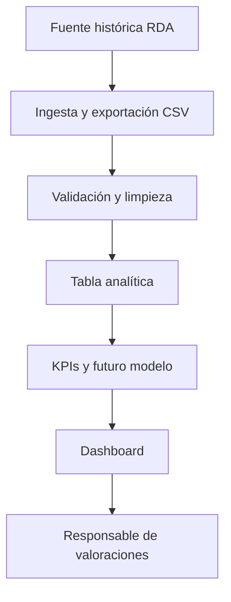

# Project brief: análisis del mercado residencial de Madrid

## 1. Resumen del proyecto

El proyecto analiza los precios anunciados de viviendas en venta en Madrid durante los cuatro trimestres de 2018 mediante `Madrid_Sale`, del dataset abierto `idealista18`. Busca ayudar a una agencia inmobiliaria ficticia a seleccionar comparables y detectar anuncios cuyo precio por metro cuadrado merece revisión.

La solución principal será un dashboard de gestión; posteriormente se añadirá un modelo predictivo como referencia complementaria. El trabajo es histórico: los precios son de oferta, no de operaciones cerradas, y no permiten recomendar precios actuales. Se mantendrá la misma fuente durante el proyecto.

## 2. Organización, responsable y decisión

**Madrid Vivienda Analytics** es una agencia ficticia dedicada a la intermediación residencial. Su equipo de valoraciones y captación necesita justificar las recomendaciones de precio con criterios consistentes. El responsable de valoraciones consultaría el dashboard semanalmente y podría seleccionar comparables y solicitar la revisión de anuncios; la decisión final seguiría siendo humana.

**Con esta herramienta, el responsable decidirá qué viviendas necesitan una revisión de su precio anunciado por m² frente a inmuebles comparables antes de recomendar un precio de salida.**

Esto apoya una estrategia de valoraciones trazables. También afecta a agentes, propietarios y compradores: una referencia poco representativa puede generar expectativas equivocadas. Las restricciones son el calendario académico, las herramientas gratuitas, la ausencia de precios de cierre y la información incompleta sobre negociación y estado interior.

La alternativa es seleccionar comparables manualmente en una hoja de cálculo. Es sencilla, pero cuesta repetir los mismos filtros y documentar las decisiones. El dashboard facilitará esa consistencia; no se presupone que mejore los resultados hasta evaluarlo.

## 3. Ficha del dataset

| Campo | Descripción |
|---|---|
| Nombre | `idealista18`, objeto `Madrid_Sale` |
| Publicador y URL | Repositorio de Antonio Páez y colaboradores: https://github.com/paezha/idealista18; anuncios procedentes de idealista, enriquecidos con información catastral y geográfica |
| Licencia | Open Database License, ODbL 1.0, declarada en el README: https://opendatacommons.org/licenses/odbl/1-0/ |
| Versión | Commit `e9ef80618f8a9cc28f672ac138f298bbd519918e` |
| Fecha registrada en el notebook | 27/10/2026, 15:06 UTC; calculada a partir de la modificación del archivo descargado, no como fecha de publicación |
| Archivo fuente | `data/Madrid_Sale.rda` en el repositorio de origen |
| Formato de trabajo | [CSV tabular](data/Madrid_Sale_original.csv) generado desde RDA, 20.254.073 bytes (20,25 MB); se conserva el original como referencia |
| Grano | Una fila es un registro de anuncio; varias filas pueden compartir identificador de inmueble y trimestre |
| Periodo | Primer a cuarto trimestre de 2018, codificados como `201803`, `201806`, `201809`, `201812` |
| Tamaño verificado en el notebook | 94.815 filas × 42 columnas; RDA de 6.738.247 bytes (6,74 MB). Sin `geometry`: 41 columnas |
| Dimensiones categóricas | `HASTERRACE` y `HASLIFT`: 0 = no, 1 = sí; `FLATLOCATIONID`: 1 = exterior, 2 = interior. También trimestre y equipamiento |
| Medidas | `PRICE` en euros, `CONSTRUCTEDAREA` en m² y `UNITPRICE` en €/m² |
| Objetivo candidato | `UNITPRICE`, precio anunciado por m² |
| Documentación | README y `man/Madrid_Sale.Rd` de la versión indicada |
| Calidad detectada | Nulos en cuatro columnas; identificadores repetidos; valores extremos y posibles anomalías geográficas |
| Fuentes adicionales | Ninguna en esta fase; no se presupone una columna de barrio |

## 4. Evidencias y preparación

El [notebook de exploración](../exploracion_madrid.ipynb) conserva código, salidas y procedencia. La carga muestra 94.815 registros, superiores al mínimo de 5.000, y cuatro trimestres completos. Los indicadores binarios permiten al menos tres dimensiones categóricas; precio y superficie aportan las medidas requeridas.

Se han encontrado **75.804 identificadores distintos y cero duplicados exactos**. Hay 13.829 identificadores repetidos, que ocupan 32.840 filas. En esta versión, cada identificador aparece en un solo trimestre. Aunque el README contempla repeticiones entre trimestres, esa situación no se observa aquí. No se eliminarán registros solo por compartir identificador.

Los nulos son: `CONSTRUCTIONYEAR`, 55.873 (58,93 %); `FLATLOCATIONID`, 6.387 (6,74 %); `FLOORCLEAN`, 3.846 (4,06 %); y `CADASTRALQUALITYID`, uno. `CADCONSTRUCTIONYEAR` no tiene nulos y se evaluará como alternativa al año declarado. Una fecha anterior a 1800 puede corresponder a un edificio histórico.

Se comprobó que `geometry` coincide con longitud y latitud en todas las filas, por lo que la exportación tabular prescinde de ella. Se detectó un registro con coordenadas a unos 415 km del centro y combinaciones muy poco plausibles de superficie y dormitorios. Se documentará su tratamiento antes de limpiar. Los filtros exploratorios no son reglas automáticas de exclusión.

El diccionario define dormitorios, categorías de equipamiento y distancias al centro en kilómetros, pero no resuelve todas las anomalías del aparcamiento ni los códigos extremos de planta. Además, contiene una cifra de 156.016 registros y 57 variables junto a otra de 94.815 y 42; se adopta la comprobada al cargar, coincidente con el README.

La limpieza definitiva sigue pendiente: conservará el original, registrará las transformaciones y cuantificará su efecto. El notebook es evidencia de auditoría inicial, no de datos ya depurados.

## 5. Hipótesis priorizadas

H1 y H2 tienen prioridad por su utilidad para seleccionar comparables; H3 y H4 refinan la comparación. Las pruebas describirán asociaciones, no causalidad.

| Hipótesis | Métrica y dirección esperada | Prueba prevista | Si se cumple / si no se cumple |
|---|---|---|---|
| H1. Mayor distancia al centro se asocia con menor precio por m² | Mediana de `UNITPRICE` por tramo de distancia; relación negativa | Dispersión y Spearman, comparando grupos de superficie | Incorporar distancia a los comparables / revisar otras variables de localización |
| H2. Mayor superficie se asocia con menor precio por m² | Mediana por intervalo de superficie; descenso esperado | Cajas y Spearman, considerando localización | Segmentar por superficie / reducir el peso de esa segmentación |
| H3. El ascensor se asocia con mayor precio por m², especialmente en plantas altas | Mediana con ascensor menos mediana sin ascensor, por planta; diferencia positiva | Tablas y cajas con tamaño de grupo, controlando superficie y localización | Incorporar el ajuste por planta y ascensor / evitar una prima general |
| H4. La terraza se asocia con mayor precio por m² | Mediana con terraza menos mediana sin terraza; diferencia positiva | Comparación por tamaño y localización | Incluir terraza en los comparables / no asumir una prima sistemática |

La exploración de H3 muestra pocos registros sin ascensor en plantas altas: nueve filas desde la planta 7. No se considerará confirmada la hipótesis sin evaluar comparabilidad y suficiencia de los grupos.

## 6. KPIs del dashboard

| KPI y cálculo | Grano y comparación | Objetivo o criterio |
|---|---|---|
| Precio típico: mediana de `UNITPRICE` | Segmento × trimestre; comparar tamaño y localización | Referencia descriptiva, sin umbral universal |
| Dispersión: percentil 75 − percentil 25 de `UNITPRICE` | Segmento × trimestre | Identificar comparaciones heterogéneas |
| Cobertura: número distinto de `ASSETID` | Segmento × trimestre | Señalar grupos con menos de 30 inmuebles; regla provisional a revisar |
| Diferencia por ascensor: mediana con ascensor − mediana sin él | Planta, tamaño, localización y trimestre | Contrastar H3, sin prima prefijada |
| Desviación del anuncio: 100 × (€/m² anunciado − referencia) / referencia | Registro de anuncio frente a mediana de comparables del mismo trimestre | Ordenar por desviación absoluta para revisión humana; umbral pendiente de validación |

Los grupos de comparables se definirán mediante filtros explícitos de superficie, localización y características. Se mostrará su cobertura. Una segmentación más precisa reduce la muestra: habrá que equilibrar semejanza y estabilidad. Las repeticiones pueden influir en medianas, aunque la cobertura cuente identificadores distintos; se evaluará ese efecto antes del dashboard final. No se fijarán objetivos de ahorro sin medición.

## 7. Solución y arquitectura

**Entradas:** tabla validada y filtros de trimestre, superficie, dormitorios, terraza y ascensor. **Lógica:** medianas, dispersión, cobertura y desviación frente a comparables. **Salidas:** indicadores, gráficos, tabla de anuncios para revisión y vista de localización aproximada.

El dashboard es prioritario frente a una aplicación completa por su menor complejidad. Posteriormente, un modelo estimará `UNITPRICE` con características físicas y geográficas. Se excluirá `PRICE` como predictor: la exploración confirma que, junto con superficie, reconstruye exactamente el objetivo. El identificador servirá para controlar repeticiones, no como característica predictiva.

| Capa | Función y herramienta | Actualización |
|---|---|---|
| Fuente | Archivo original y commit de GitHub | Descarga de versión fijada |
| Ingesta | Lectura con `rdata`; exportación con pandas | Al reconstruir los datos |
| Limpieza y calidad | Validaciones y registro de cambios con pandas | En cada ejecución |
| Modelo de datos | Tabla tabular CSV; Parquet si se necesita | Tras validar transformaciones |
| Analítica | KPIs y futuro modelo en Python | Tras actualizar la tabla |
| Dashboard | Power BI con filtros y comparables | Tras exportar resultados |

## 8. Mantenimiento, riesgos y límites

El autor mantendrá código, datos y documentación. El brief estará en `project/`, el notebook de apoyo en la raíz y los datos generados en `project/data/`. La descarga se reconstruirá desde la versión fijada. Se detendrá el proceso ante cambios incompatibles de columnas o tipos.

La consulta semanal describe el uso hipotético del responsable; la fuente histórica no tendrá actualización semanal. El prototipo se refrescará cuando se revisen las transformaciones. Una tabla basta para este volumen; no se justifica mantener una base de datos.

Los principales riesgos son cobertura parcial de una plataforma, calidad y repetición de registros, y desfase temporal. El último trimestre concentra el 46,7 % de las filas; las diferencias entre trimestres pueden reflejar cambios de composición. Un único año limita las conclusiones sobre estacionalidad.

La fuente informa de perturbaciones de precios y coordenadas para anonimizar. No se intentará identificar propietarios ni publicar direcciones exactas. Se mantendrá la atribución y se comprobarán las condiciones ODbL al redistribuir datos derivados. El máximo observado cercano a 10.000 €/m² sugiere una posible limitación del segmento alto, pero no demuestra un filtro. Las recomendaciones conservarán revisión humana y explicaciones de cobertura.

## 9. Fuentes y evidencias

- [Dataset, licencia declarada y descripción general](https://github.com/paezha/idealista18/tree/e9ef80618f8a9cc28f672ac138f298bbd519918e).
- [Diccionario de Madrid_Sale](https://github.com/paezha/idealista18/blob/e9ef80618f8a9cc28f672ac138f298bbd519918e/man/Madrid_Sale.Rd).
- [Licencia ODbL 1.0](https://opendatacommons.org/licenses/odbl/1-0/).
- Rey-Blanco, D., Arbues, P., Lopez, F. y Paez, A. *A geo-referenced micro-data set of real estate listings for Spain’s three largest cities*. [Artículo asociado](https://doi.org/10.1177/23998083241242844).
- Enunciado docente: *The end-to-end project: brief for the dashboard session (session 7)*, `PROJECT_BRIEF.md`.
- [Notebook con resultados de exploración](../exploracion_madrid.ipynb).
